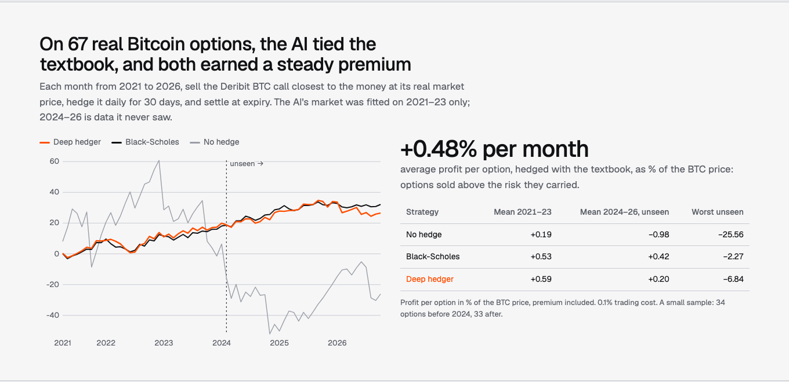
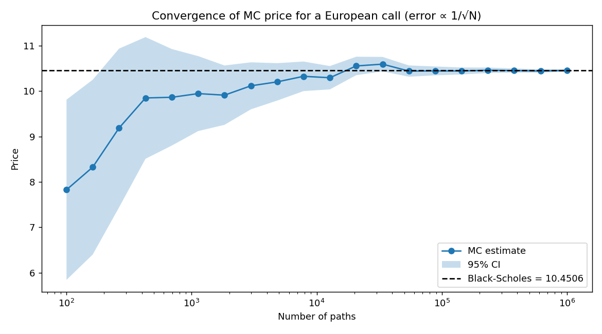
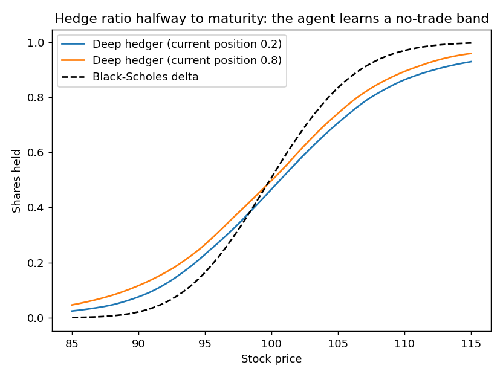

# Quant Projects

Two quantitative finance projects, built from first principles in Python and PyTorch, and
tested on real market data: **20 years of S&P 500 (SPY) and VIX** history, and **67 real
traded Bitcoin options** from Deribit.


<sub>The interactive demo (`deep_hedging/demo/index.html`): the trained network runs in the page. Move the dials and it re-hedges 1,500 simulated months.</sub>

## Projects

| | Project | In one line |
|---|---|---|
| 🧠 | **[Deep hedging](deep_hedging/)** | A neural network learns to hedge options under trading costs, and is tested against Black-Scholes on real SPY history and real Bitcoin options |
| 🎲 | **[Monte Carlo engine](monte_carlo/)** | Option pricing checked against Black-Scholes, exotic options, variance reduction (≈1,300× for Asian options) and portfolio VaR / Expected Shortfall |

## Key results

**Deep hedging**
- On simulated markets with crashes, the network cuts the average of the worst 5% of
  losses by **9%** compared with the Black-Scholes delta hedge, mostly by **trading less**
  and paying less in costs.
- On **real SPY history (2005–2026)**, its 95% Value-at-Risk is **8% lower** than
  Black-Scholes. Its worst-5% average is about the same.
- On **real Bitcoin options**, judged strictly out of sample (the model was fitted on
  2021–23, tested on 2024–26), it **does not beat** Black-Scholes. The analysis explains why.
- Both hedged strategies earned a steady **+0.48% per option per month** from 2021 to 2026:
  a measured *volatility risk premium*. Real BTC options were priced above the risk they carried.



**Monte Carlo**
- European call: **10.46 ± 0.07** by simulation vs **10.45** by the Black-Scholes formula.
- Asian option with a control variate: about **1,300× less variance** than plain Monte Carlo.
- 3-stock portfolio: 10-day 99% VaR **8.4%**, Expected Shortfall **9.5%**.

<p>


</p>
<sub>Left: Monte Carlo converging to the exact price. Right: the network's learned hedge is flatter than Black-Scholes delta, so it trades less.</sub>

## How it fits together

```
Real data ──► calibrate a market model ──► Monte Carlo: simulate 200k months ──► train the hedger
(SPY, VIX,      (Heston + jumps)                                                    │
 Deribit BTC)                                                                       ▼
                       compare with Black-Scholes on simulated, real SPY and real BTC options
```

The Monte Carlo engine is the foundation. The deep hedging project uses the same idea,
simulating many possible futures, to create the training data for the network.

## Repository layout

```
monte_carlo/        Monte Carlo engine: paths, pricing, risk        → python main.py
deep_hedging/
  dh/               simulators, calibration, Deribit loader, network and training
  main.py           SPY experiment (Heston vs Bates training)       → about 6 min on CPU
  btc_main.py       real Bitcoin options experiment                 → about 3 min on CPU
  demo/             interactive browser demo (export_demo.py builds it)
docs/               screenshots used in this README
```

## Run it

```bash
pip install numpy scipy pandas matplotlib torch "yfinance>=0.2.50"

cd monte_carlo && python main.py
cd ../deep_hedging && python main.py && python btc_main.py
python export_demo.py     # rebuild the demo, then open demo/index.html
```

All data is free and downloaded automatically: Yahoo Finance for SPY and VIX, Deribit's
public API for Bitcoin. No API keys are needed.

## Tech

Python · NumPy · SciPy · pandas · PyTorch · Matplotlib · vanilla JavaScript and SVG for the demo

## References

- Buehler, Gonon, Teichmann & Wood (2019). *Deep Hedging*. Quantitative Finance.
- Heston (1993). *A closed-form solution for options with stochastic volatility.*
- Bates (1996). *Jumps and stochastic volatility.*
- Rockafellar & Uryasev (2000). *Optimization of conditional value-at-risk.*
- Glasserman (2003). *Monte Carlo Methods in Financial Engineering.*
