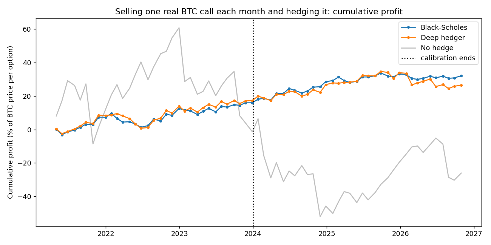

# Deep Hedging: a neural network that hedges options under transaction costs

The textbook Black-Scholes hedge assumes free, continuous trading and constant volatility.
Real markets have neither. This project trains a neural network to hedge a short
call option in a market calibrated to real SPY and VIX data, with 0.2% trading costs. It
minimises tail risk (CVaR 95%) and is evaluated on both simulated and **real** SPY history.

Based on Buehler, Gonon, Teichmann & Wood, *Deep Hedging* (Quantitative Finance, 2019).

## Pipeline
1. **Data:** daily SPY and VIX since 2005 (yfinance, cached to `data/`).
2. **Calibration:** Heston stochastic volatility model, fitted to the VIX time series
   (κ = 9.8, long-run vol 21%, vol-of-vol 0.65, ρ = −0.75), plus jumps for the Bates model.
3. **Simulation:** 200k paths per world (Heston, and Bates with jumps), 30 daily hedging dates.
4. **Training:** a feed-forward network maps (time left, log-moneyness, current vol, current
   position) to the number of shares held. The loss is CVaR of the hedging loss, via the
   Rockafellar–Uryasev formulation. The learned threshold is the seller's indifference price.
5. **Evaluation:** compared against the Black-Scholes delta hedge and no hedge, on new
   simulated paths and on 1,096 real 30-day SPY windows.

## Results (P&L per option sold, S0 = 100, premium excluded)

Two hedgers are trained: one in a Heston world (smooth moves only) and one in a **Bates**
world (Heston plus sudden jumps). Jumps are calibrated from SPY: about 1 per year, mean −3.0%,
std 5.6%. A "jump" is a day whose move is more than 3× what the VIX predicted.

**Simulated test set with jumps (50k Bates paths)**
| Strategy | Mean | Std | VaR 95 | CVaR 95 |
|---|---|---|---|---|
| No hedge | −2.96 | 3.87 | 10.82 | 13.18 |
| Black-Scholes delta | −3.49 | 0.90 | 4.91 | 6.02 |
| Deep hedger (Heston) | −3.36 | 0.91 | **4.65** | 5.52 |
| **Deep hedger (Bates)** | **−3.32** | 1.01 | 4.72 | **5.45** |

**Real SPY, 2005–2026 (1,096 windows)**
| Strategy | Mean | Std | VaR 95 | CVaR 95 |
|---|---|---|---|---|
| No hedge | −2.76 | 3.19 | 8.57 | 11.71 |
| Black-Scholes delta | −2.66 | 1.19 | 4.62 | 6.45 |
| Deep hedger (Heston) | −2.57 | 1.36 | 4.61 | 6.46 |
| **Deep hedger (Bates)** | **−2.55** | 1.40 | **4.27** | **6.42** |

### Interpretation
- Both hedgers save money by **trading less** than Black-Scholes. Their hedge is flatter
  (see `learned_delta.png`), which cuts transaction costs.
- On simulated jump paths, both beat Black-Scholes on tail risk (CVaR −9% to −10%).
- On real SPY, adding jumps to training gives the **best result on every measure except
  std**: VaR improves by 8% over Black-Scholes. CVaR improves only slightly; the
  Heston-trained hedger just ties Black-Scholes there.
- **Caveat:** the real test has about 55 tail windows, and the windows overlap, so small
  CVaR differences are within noise. The gap left on real data suggests jumps alone
  don't explain real crashes: volatility clustering and regime changes matter too.
- Std is slightly higher on purpose: the agent minimises CVaR, not variance.

## Part 2: Real Bitcoin options (Deribit) — `python btc_main.py`

The SPY test hedges a *hypothetical* option. Here we hedge **67 real, traded monthly BTC call
options** (2021–2026, free Deribit history), each sold at its **real market price** 30 days
before expiry, hedged daily with BTC, and settled at Deribit's real settlement price.

- **Data:** BTC index price at 08:00 UTC (expiry time), DVOL (BTC implied-vol index), and the
  exchange mark price of each option, all from Deribit's public API.
- **Out-of-sample by design:** the Bates model is calibrated on **2021–2023 only**;
  2024–2026 is never used for calibration or training.
- **Training:** random strikes (94–106), with each path's volatility regime drawn from real
  2021–23 DVOL levels (domain randomization). Trading cost 0.1%.

**Profit per option sold, % of BTC price (premium included)**
| Strategy | 2021–23 mean | 2024–26 mean (unseen) | 2024–26 worst | All: std |
|---|---|---|---|---|
| No hedge | +0.19 | −0.98 | −25.56 | 10.42 |
| Black-Scholes delta | +0.53 | **+0.42** | **−2.27** | **1.83** |
| Deep hedger | **+0.59** | +0.20 | −6.84 | 2.35 |



### What we learned (honestly)
1. **The deep hedger did not beat Black-Scholes on unseen real options.** The two track each
   other almost exactly for five years. The gap comes from a few months in 2026. With
   cheap trading (0.1%) and huge BTC volatility, cost savings, the agent's edge on SPY,
   matter little, and the textbook hedge is already close to optimal.
2. **Domain randomization didn't fix it.** BTC was far calmer in 2024–26 (DVOL mean 49% vs 70%),
   but training across many vol regimes changed results very little. So the gap is not
   only a vol-level mismatch.
3. **Hedged option selling earned a steady premium.** Both hedged strategies made about
   +0.45% per option, month after month, while the unhedged seller swung between +60%
   and −50%. Real BTC options were priced above the risk they carried: the
   *volatility risk premium*, measured here on real trades.
4. **Caveats:** 67 options is a small sample (33 unseen). Options are treated as USD-settled
   (Deribit's settle in BTC), and costs are a flat 0.1%.

We stopped tuning here on purpose: tuning the model until it wins on 2024–26 would turn the
test set into training data.

## Run
```bash
pip install numpy scipy pandas matplotlib torch "yfinance>=0.2.50"
python main.py      # SPY experiment, about 6 min on a laptop CPU
python btc_main.py  # real BTC options experiment, about 3 min
```
Outputs: `outputs/pnl_simulated.png`, `pnl_real_spy.png`, `learned_delta.png`,
`training_loss.png`, `deep_hedger_heston.pt`, `deep_hedger_bates.pt`.

## Next steps
- Residual policy: learn a correction on top of Black-Scholes delta rather than a hedge from scratch
- Hedge with real market option prices (vega hedging using the Deribit option chain)
- Generative model (GAN or diffusion) trained on real paths as the simulator
- Recurrent network (LSTM) policy, with the VIX term structure as an extra input
- Hedge with options as well as stock (vega hedging)
- Compare different risk preferences: entropic risk vs CVaR vs variance
