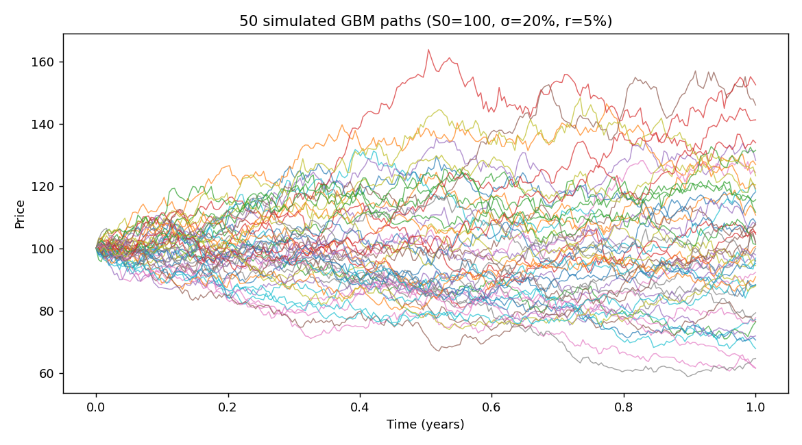
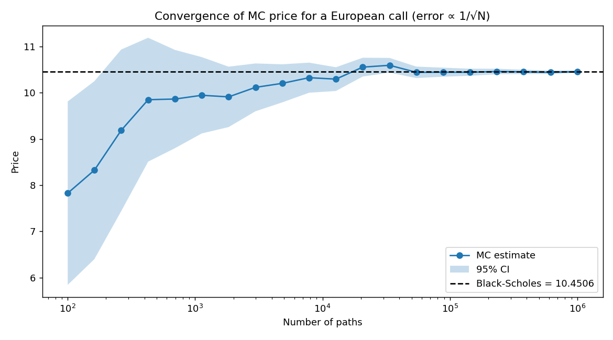
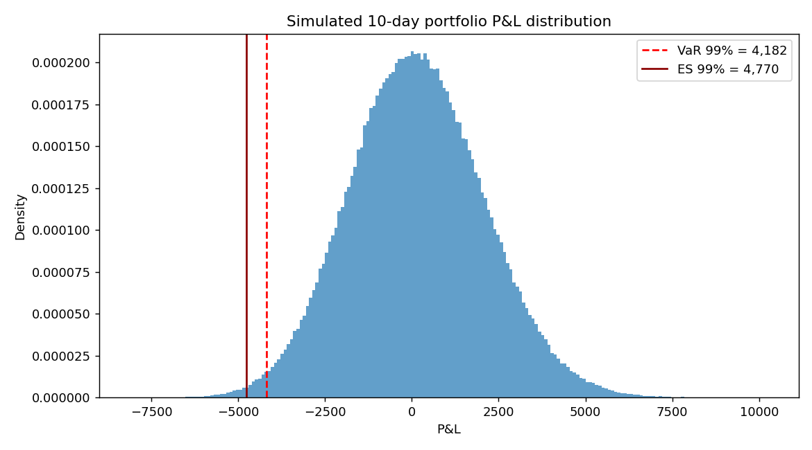

# Monte Carlo Simulation for Quantitative Finance

Price options and measure portfolio risk by simulating thousands of possible futures, then
check the answers against exact formulas.



## The idea in one paragraph

When there is no formula for an answer, simulate the random process many times and average
the results. Stock prices are simulated as Geometric Brownian Motion. An option's fair
price is the average payoff across all simulated futures, discounted to today. The error
shrinks like 1/√N, so variance-reduction tricks matter as much as the number of paths.

## What's inside

| Module | Contents |
|---|---|
| [`mc/paths.py`](mc/paths.py) | GBM paths (exact log-normal steps), and correlated assets via Cholesky decomposition |
| [`mc/pricing.py`](mc/pricing.py) | European options (checked against Black-Scholes), arithmetic Asian options, up-and-out barrier options |
| [`mc/risk.py`](mc/risk.py) | Portfolio Value-at-Risk and Expected Shortfall (CVaR) |

**Variance reduction:** antithetic variates, and a control variate based on the geometric
Asian option, which has a closed-form price.

## Results

S0 = 100, K = 100, r = 5%, σ = 20%, T = 1 year.

| Instrument | Monte Carlo (95% CI) | Exact |
|---|---|---|
| European call, 200k paths | 10.463 [10.399, 10.528] | **10.451** |
| European put, 200k paths | 5.589 [5.551, 5.627] | **5.574** |
| Asian call, plain MC | 5.774 ± 0.036 (SE) | — |
| Asian call, control variate | 5.783 ± **0.001** (SE) | — |
| Up-and-out call, barrier 130 | 3.565 ± 0.020 (SE) | — |

The control variate cuts the Asian option's variance by about **1,300×**: the same accuracy
as 1,300 times more paths.



### Portfolio risk

A €50,000 portfolio of three correlated stocks, 10-day horizon, 500k scenarios:

| Measure (99%) | Loss | % of portfolio |
|---|---|---|
| Value-at-Risk | €4,182 | 8.36% |
| Expected Shortfall | €4,770 | 9.54% |



## Run

```bash
pip install numpy scipy matplotlib
python main.py      # prints all results, saves plots to outputs/
```

## Where this leads

This engine is the foundation of the [deep hedging project](../deep_hedging/), which uses
the same simulation idea to generate training data for a neural network.
